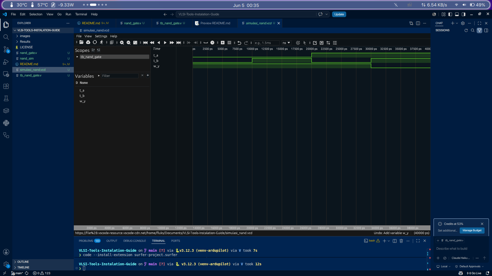

<div align="center">


A comprehensive and well-structured guide for installing and configuring *open-source analog and digital VLSI design tools* integrated with the **SkyWater 130nm PDK**.
</div>


<div align="center">

### 🎯 Target Audience

🎓 IC Design Students & Researchers &nbsp;|&nbsp; 🔰 Beginner Analog &amp; Digital VLSI Learners &nbsp;|&nbsp; 💻 Xschem + Ngspice + Magic + OpenLane 2 Users &nbsp;|&nbsp; 🐧 Ubuntu Linux

</div>

---

## 📚 Table of Contents

1. [System Prerequisites](#1-system-prerequisites)
2. [Tools & Their Functions](#2-tools--their-functions)
3. [Nix Package Manager Installation](#3-nix-package-manager-installation)
4. [System Dependencies Installation](#4-system-dependencies-installation)
5. [EDA Tools Installation](#5-eda-tools-installation)
6. [Setup OpenLane 2](#6-setup-openlane-2)
7. [Environment Variables & PDK Integration](#7-environment-variables-configuration-and-tools-integration-with-sky130-pdk)
8. [Running Design Examples and Simulations](#8-running-design-examples-and-simulations)
9. [Notes & Tips](#9-notes--tips)

---

## 1. System Prerequisites

| Requirement | Specification |
| :-- | :-- |
| 🖥️ **OS** | Ubuntu 20.04 / 22.04 LTS <sub>(22.04 recommended for VM)</sub> |
| 💾 **Disk Space** | ≥ 15 GB |
| 🧠 **RAM** | Minimal 8 GiB <sub>(16 GiB recommended)</sub> |
| ⚙️ **Processor** | Quad-core @ 2.0 GHz+ <sub>(Intel 6th Gen+ / AMD Ryzen 1000+)</sub> |

<div align="center">


<sub>📷 <i>Example of Ubuntu environment</i></sub>
</div>

---

## 2. Tools & Their Functions

| Tool | Function | Status |
| :-- | :-- | :--: |
| **Xschem** | Schematic capture & netlist generation |  |
| **Ngspice** | SPICE simulator |  |
| **GAW** | Waveform viewer |  |
| **Magic** | VLSI layout editor |  |
| **Netgen** | LVS (Layout vs. Schematic) |  |
| **Irsim** | Digital Simulator |  |
| **KLayout** | Layout viewer & DRC verification |  |
| **OpenLane 2** | Python & Nix-based RTL-to-GDSII automation |  |

<div align="center">


<sub>📷 <i>Analog & Digital IC Design Flow</i></sub>
</div>

---

## 3. Nix Package Manager Installation

> ⚠️ **Penting:** **Jangan** menginstal Nix via `apt` karena versinya usang. Gunakan installer resmi Determinate Systems yang menyertakan cache OpenLane.

### 3.1 Install Curl

```bash
sudo apt-get update && sudo apt-get install -y curl
```

### 3.2 Install Nix & Set OpenLane Binary Cache

```bash
curl --proto '=https' --tlsv1.2 -sSf -L https://install.determinate.systems/nix | sh -s -- install --no-confirm --extra-conf "    extra-substituters = https://openlane.cachix.org    extra-trusted-public-keys = openlane.cachix.org-1:qqdwh+QMNGmZAuyeQJTH9ErW57OWSvdtuwfBKdS254E="
```

> ⚠️ **Tutup dan buka kembali terminal kamu setelah langkah ini selesai.**

### 3.3 Verifikasi / Tambahkan Cache Manually (Jika Nix Sudah Ada)

```bash
nix-env -f "<nixpkgs>" -iA cachix
sudo env PATH="$PATH:$HOME/.nix-profile/bin" cachix use openlane
sudo pkill nix-daemon
```

---

## 4. System Dependencies Installation

### 4.1 System Update & Git Setup

```bash
sudo apt update && sudo apt upgrade -y
sudo apt install -y build-essential gcc make perl git
git config --global user.name "Your Name"
git config --global user.email "email@domain.com"
```

### 4.2 EDA Supporting Libraries

```bash
sudo apt install -y \
    m4 tcsh csh libx11-dev libx11-xcb-dev tcl-dev tcllib tk-dev \
    libcairo2-dev mesa-common-dev libglu1-mesa-dev libncurses-dev clang \
    bison flex libreadline-dev gawk libffi-dev graphviz xdot pkg-config \
    python3 python3-pip libboost-system-dev adms autoconf automake libtool \
    libxpm-dev libxaw7-dev libssl-dev libgtk-3-dev libboost-python-dev \
    libboost-filesystem-dev zlib1g-dev xterm graphicsmagick ghostscript vim
```

<div align="center">


<sub>📷 <i>Overview perangkat & dependensi sistem yang terpasang</i></sub>
</div>

---

## 5. EDA Tools Installation

### 5.1 Directory Preparation

```bash
mkdir -p ~/open_source/tools
cd ~/open_source/tools
```

### 5.2 Xschem <sub>(Schematic Editor)</sub>

```bash
git clone https://github.com/StefanSchippers/xschem.git
cd xschem
./configure
make -j$(nproc)
sudo make install
cd ..
```

<div align="center">


<sub>📷 <i>Xschem run</i></sub>
</div>

### 5.3 Ngspice <sub>(Simulator)</sub>

```bash
git clone https://git.code.sf.net/p/ngspice/ngspice ngspice_git
cd ngspice_git
./autogen.sh --adms
mkdir release && cd release
../configure \
    --with-x \
    --enable-xspice \
    --enable-cider \
    --enable-openmp \
    --with-readline=yes \
    --disable-debug
make -j$(nproc)
sudo make install
cd ../..
```

<div align="center">


<sub>📷 <i>Ngspice CLI</i></sub>
</div>

### 5.4 GAW <sub>🔶 Optional</sub>

```bash
git clone https://github.com/StefanSchippers/xschem-gaw
cd xschem-gaw
aclocal
automake --add-missing
autoconf
./configure
sudo make -j$(nproc)
sudo make install
cd ..
```

<div align="center">


<sub>📷 <i>GAW waveform</i></sub>
</div>

### 5.5 Magic <sub>(Layout Editor)</sub>

```bash
git clone https://github.com/RTimothyEdwards/magic
cd magic
./configure
make -j$(nproc)
sudo make install
cd ..
```

<div align="center">


<sub>📷 <i>Magic layout editor</i></sub>
</div>

### 5.6 Netgen <sub>(LVS Tool)</sub>

```bash
git clone https://github.com/RTimothyEdwards/netgen
cd netgen
./configure
make -j$(nproc)
sudo make install
cd ..
```

<div align="center">


<sub>📷 <i>Netgen LVS</i></sub>
</div>

### 5.7 Irsim <sub>(Digital Simulator)</sub>

```bash
git clone https://github.com/RTimothyEdwards/irsim
cd irsim
./configure
sudo make
sudo make install
cd ..
```

### 5.8 KLayout <sub>(Layout Viewer)</sub>

```bash
mkdir -p ~/open_source/tools/klayout
cd ~/open_source/tools/klayout
sudo apt install -y \
  gcc g++ make \
  qtbase5-dev qttools5-dev libqt5xmlpatterns5-dev \
  qtmultimedia5-dev libqt5multimediawidgets5 libqt5svg5-dev \
  ruby ruby-dev python3 python3-dev libz-dev vim-gtk3
```

Unduh paket `.deb` dari [klayout.de/build.html](https://www.klayout.de/build.html) dan simpan di `~/open_source/tools/klayout`.

<div align="center">


<sub>📷 <i>Pilih versi paket .deb KLayout yang sesuai</i></sub>
</div>

Jalankan instalasi:

```bash
sudo dpkg -i klayout_*.deb
sudo apt-get install -f
```

### 5.9 Icarus Verilog & Waveform Viewer <sub>(VS Code + Surfer)</sub>

```bash
sudo apt update && sudo apt install -y iverilog
```

<div align="center">


<sub>📷 <i>Visualisasi Waveform VCD dengan Extension Surfer di VS Code</i></sub>
</div>

---

## 6. Setup OpenLane 2

### 6.1 Clone OpenLane 2 Repository

```bash
cd ~
git clone https://github.com/efabless/openlane2
```

### 6.2 Masuk ke Nix Shell & Uji Instalasi

```bash
cd ~/openlane2
nix-shell
```

*(Pemuatan pertama kali membutuhkan waktu ~10 menit untuk mengunduh binary dari Cachix).*

Setelah masuk ke dalam *devshell* (`❄️ impure (devshell)`):

```bash
openlane --smoke-test
```

<div align="center">


<sub>📷 <i>Hasil <code>openlane --smoke-test</code> yang berhasil di dalam devshell</i></sub>
</div>

---

## 7. Environment Variables Configuration and Tools Integration with Sky130 PDK

### 7.1 Setup Directory Desain

```bash
mkdir -p ~/design/{netgen,irsim}
```

### 7.2 PDK Root Configuration

```bash
nano ~/.bashrc
```

Tambahkan baris berikut di bagian akhir file:

```bash
# Path PDK
export PDK_ROOT=$HOME/.ciel

set_sky130a() {
    export PDK=sky130A
    ln -sf $PDK_ROOT/sky130A/libs.tech/ngspice/spinit ~/.spiceinit
    if [[ -t 1 ]]; then
     echo "PDK is now set to: $PDK"
    fi
}

set_sky130b() {
    export PDK=sky130B
    ln -sf $PDK_ROOT/sky130B/libs.tech/ngspice/spinit ~/.spiceinit
    if [[ -t 1 ]]; then
     echo "PDK is now set to: $PDK"
    fi
}

set_sky130a

alias magic='magic -rcfile $PDK_ROOT/$PDK/libs.tech/magic/$PDK.magicrc'
alias xschem='xschem --rcfile $PDK_ROOT/$PDK/libs.tech/xschem/xschemrc'
```

```bash
source ~/.bashrc
```

### 7.3 Verifikasi Integrasi Alat dengan Sky130 PDK

Uji Xschem terhubung ke Sky130:

```bash
xschem
```

<div align="center">


<sub>📷 <i>Xschem connected to Sky130</i></sub>
</div>

Uji Magic terhubung ke Sky130:

```bash
magic
```

<div align="center">


<sub>📷 <i>Magic connected to Sky130</i></sub>
</div>

### 7.4 Integrasi Netgen

```bash
cd ~/design/netgen
ln -sf $PDK_ROOT/sky130A/libs.tech/netgen/setup.tcl sky130A_setup.tcl
ln -sf $PDK_ROOT/sky130B/libs.tech/netgen/setup.tcl sky130B_setup.tcl
```

<div align="center">


<sub>📷 <i>Netgen PDK Setup</i></sub>
</div>

### 7.5 Integrasi KLayout

```bash
mkdir -p ~/.klayout/tech
cd ~/.klayout/tech
ln -sf $PDK_ROOT/sky130A/libs.tech/klayout sky130A
```

<div align="center">


<sub>📷 <i>KLayout Connected with Sky130</i></sub>
</div>

---

## 8. Running Design Examples and Simulations

Kloning contoh desain inverter:

```bash
cd ~
git clone https://github.com/raisrmdhnar2/VLSI_Inverter_Design
cd VLSI_Inverter_Design
```

### 8.1 How to run a design on OpenLane 2?

**1. Masuk ke direktori OpenLane 2 & aktifkan nix-shell:**

```bash
cd ~/openlane2
nix-shell
```

**2. Jalankan flow OpenLane 2:**

Gunakan perintah `openlane` diikuti lokasi `config.json` atau `config.yaml` dari proyek kamu:

```bash
openlane --pdk sky130A ~/VLSI_Inverter_Design/Digital/inverter/config.json
```

<div align="center">


<sub>📷 <i>Hasil layout akhir (GDSII) dari flow OpenLane 2</i></sub>
</div>

---

## 9. Notes & Tips

> 💡 **General Tips & Troubleshooting**
>
> - ⚠️ Magic menyembunyikan hierarki secara default. Pilih semua area lalu tekan **`x`** untuk menampilkan.
> - ⚡ **OpenLane 2**: Selalu pastikan berada di dalam `nix-shell` sebelum mengeksekusi perintah `openlane`.
> - 🔍 Gunakan `nix-shell -v` jika ingin melihat detail indikator proses *download* saat memasuki lingkungan Nix.

<div align="center">

---
<sub>Made for open-source ASIC / analog-digital IC design learners • SkyWater 130nm + OpenLane 2</sub>
</div>